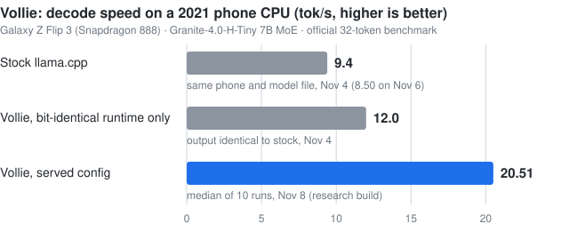

# Woobeen Back

**I make LLMs run well on small devices, and I have been building AI products since 2020.**

On-device AI · LLM compression · MLOps · Mobile AI

📍 Seoul, Korea · remote · UTC-aligned hours
📧 [woobin3069@gmail.com](mailto:woobin3069@gmail.com) · 💼 [LinkedIn](https://linkedin.com/in/woobeen-back-a29ba5259)
🟢 Looking for full-time remote roles in on-device / edge LLM inference, model compression, or mobile AI (available after military discharge, Feb 2027).

---

## What I work on

- **Inference runtime:** llama.cpp / GGML CPU work on ARM: NEON kernels, expert prefetch, thread and memory behavior, profiled per operator and per token.
- **Correctness:** output checked bit-identical across batch sizes, quality gated by perplexity, claims written down before the runs.
- **Compression:** mixed-precision GGUF quantization and KV-cache quantization; public models 25–35% smaller than their Q8_0 files at +2–7% perplexity.

---

## Highlights

- **Shipped on-device AI to the public.** On a 4-person team I owned all AI and MLOps for [Ollie](https://apps.apple.com/kr/app/ollie-private-ai-talk/id6740768187), which reached Product Hunt *Product of the Week #3*.
- **Made a 7B model run at 20 tok/s on a 2021 phone CPU.** [Vollie](#vollie--on-device-llm-runtime-tuning) is my llama.cpp runtime work, built during Army service.
- **Upstream contribution, open and under review.** [ggml-org/llama.cpp #31378](https://github.com/ggml-org/llama.cpp/pull/31378) adds a Metal kernel for `GET_ROWS_BACK` (F32), tested on Apple M4 Pro with `test-backend-ops`. The PR includes benchmarks, including the sizes where it is slower than the CPU. Not merged.
- **Led a team as a first-year student.** At Eighty 8 Nine I led 4 engineers to launch Noodle4.

```
2020 Latitude / AI Dungeon (volunteer) → 2023 Noodle4 lead (UK) → 2024 Peekaboolabs AI Lead (Korea) → 2025–27 Army service, building Vollie
```

---

## Projects

### Vollie — on-device LLM runtime tuning
*Built during military service · Android · Galaxy Z Flip 3 (Snapdragon 888, 8 GB) · Granite-4.0-H-Tiny (7B mixture-of-experts) · [github.com/hoeio/vollie](https://github.com/hoeio/vollie)*



- Patched llama.cpp CPU runtime: **20.51 tok/s median** over 10 runs, against 9.4 and 8.50 for stock settings on the same phone and file (about 2.2×).
- The claim rule ("median of 10 plain runs ≥ 20.0, never the best run") and a prediction (central 19.0) were logged before the run. The result came in above the predicted range (18.0–20.0), and the log says so. Quality cost: **+1.91%** perplexity, inside a pre-set +2% budget.
- Picks CPU cores, threads, context size, and cache format per phone, and backs off as the phone heats up.
- **Check it without a phone:** [`tools/reproduce.sh`](https://github.com/hoeio/vollie/blob/main/tools/reproduce.sh) rebuilds llama.cpp with the patches on a laptop and checks bit-identity and the perplexity gate. The speed numbers need the phone.
- *Limits:* a cold start is slower (12.3–18.5 tok/s), and so far it is one phone and one model.

<details>
<summary>More on Vollie</summary>

- Speed comes from a router-weight expert-skip rule, a two-stage output head, a sampler fast path, and a fused expert kernel. The bit-identical part of the runtime alone gives 12.0.
- Got OpenCL running on the Adreno 660 GPU after diagnosing three blockers (an OpenCL 2.0 mismatch, lost native logs, a kernel-compiler bug), then measured it at 0.7–2.9 tok/s, always below the CPU. Serving stays on the CPU, with a self-check that falls back if a driver misbehaves.
- Saves the model's state after each reply, so a follow-up in a 2,000-token chat is read in ~3 s instead of ~110 s (calculated from measured read speed, not measured end-to-end).
- Wrote up what did not help next to what did: draft-model speculation (0.48–0.76× the plain rate on the phone), n-gram, EAGLE-3 and MTP drafting, early exit (+2.5% perplexity for the cheapest layer), and several cache and kernel ideas.
- Research build 2.2.21+44 (kit r16). A production build with the same configuration is packaged and host-checked; the store app is not yet updated with it.

</details>

### Open-model compression at Peekaboolabs
*Mixed-precision GGUF quantization · scripts and results: [hoeio/test-ondevice](https://github.com/hoeio/test-ondevice)*

| Model | Size vs. public Q8_0 | Perplexity change |
|---|---|---|
| EXAONE 3.5 2.4B | **35% smaller** (1.84 GB vs 2.84 GB) | +2.4% English, +3.2% Korean |
| Gemma 3 1B | **25% smaller** | +2% English, +7% Korean |

<sub>The two best of ten compressed files; the repo's report lists all ten, including one 3B variant at +453% English perplexity. llama.cpp on WikiText-2 and a Korean Wikipedia sample, context 512, first 30 chunks, so differences of a few percent are within noise. Reference is Q8_0, not FP16. Re-run on a Mac in Nov 2026.</sub>

### Also: NeuralPet — does real fly wiring help a learning rule?
*Side research project, CPU only · [github.com/hoeio/neuralpet](https://github.com/hoeio/neuralpet)*

- A digital "pet" learning with the *Drosophila* mushroom-body connectome. Pre-registered plans, 20+ seeds, confidence intervals. **Main result: real wiring did not beat a degree-preserving shuffle.** Null and inconclusive results are in the [report](https://github.com/hoeio/neuralpet/blob/main/reports/FINAL.md).

---

## Experience

### Mandatory Military Service — Republic of Korea Army · Aug 2025 – Feb 2027
- Built internal automation tools for an artillery brigade, used by 30+ personnel.
- Won an Army Ideathon award (2026); completed the KAIST SW Education Center AI-SW course for ROKA (2026).

### AI Lead — Peekaboolabs · Dec 2024 – Jul 2025 · Seoul, on-site
*4-person seed-stage startup. Accepted to Smilegate's Orange Planet (Apr 2025). A ₩500M seed round was announced in Oct 2025, after my departure.*

- Owned every AI model, all MLOps, and model compression for the company's on-device products.
- Shipped **[Ollie](https://apps.apple.com/kr/app/ollie-private-ai-talk/id6740768187)**, an on-device AI chatbot — [Product Hunt](https://www.producthunt.com/products/lora-2) Product of the Week #3.
- Open-sourced **[Lora-SDK](https://pub.dev/packages/lora_sdk)**, the on-device LLM SDK behind Ollie, as a Flutter package (few packages could run on-device models in Flutter).
- Built **[Carve](https://web.archive.org/web/20250622214924/https://carve.peekaboolabs.ai/)** (site as of Jun 2025), an on-device AI optimization platform: 100+ waitlist, "BBB" technology rating from KIBO (Korea Technology Finance Corporation).

<details>
<summary>More from Peekaboolabs</summary>

- Converted open models to GGUF/GGML or TFLite and tested them on real phones (e.g. EXAONE 3.5, Gemma 3, Llama 3.2, Mistral 7B), and compressed the originals with several techniques.
- Used usage data from the live on-device app to see that demand was strongest among users on modest phones without NPU support, so I targeted models under 2–3 GB. Ollie came out of that.
- Worked on Core ML and NPU (Snapdragon, Exynos) optimization.
- Ran models on-device across every project: ONNX Runtime (first, in a mobile photo-editing app), then GGUF with llama.cpp after moving to Flutter, plus Core ML on iOS and LiteRT on Android.
- Worked with Intel and LG on on-device AI projects.
- Part of the Korea University Startup Station (KUBS) and Seoul Startup Hub × 500 Global expansion program cohorts.
- Hired after a freelance project with the founder.

</details>

### Freelance AI Engineer · Aug – Dec 2024 · remote
- **Livestock monitoring** — YOLO-based vision system that flags abnormal animal behavior. *Working system.*
- **On-device personalization** — fine-tuned Stable Diffusion on a user's selfies with several LoRA approaches to generate images on the phone. *Prototype.*
- **Screen agent** — a vision model finds UI elements on a computer screen and Selenium clicks them. *Working system.*

### Lead AI Engineer — Eighty 8 Nine · Feb 2023 – Aug 2024 · remote, UK (later Technical Adviser)
*Full-time alongside university studies.*

- Led 4 engineers to launch **[Noodle4](https://web.archive.org/web/20240430172023/https://www.noodle4.com/)** (site as of Apr 2024), an AI service that matches brands with influencers and reviews submitted video ads.
- Owned VQA and LLM development and MLOps deployment, working with 3 frontend/backend engineers.

<details>
<summary>More from Eighty 8 Nine</summary>

- Researched newer Llama-based VQA approaches and put them into production.
- Built Noodle4's content-review system with ViLT, LLaVA, and qllama (VQA was the main challenge); added a basic defense against influencers gaming the review (inserting content or other tricks to pass the AI check or inflate scores); deployed on AWS.

</details>

### Volunteer contributor (unpaid) — Latitude / AI Dungeon · Jul 2020 – Nov 2021 · remote, US
*While in high school.* Joined by sending the team a technical proposal; ran model-compression experiments (distillation, quantization, pruning).

---

## Research

- **AI4F — 1st Workshop on LLMs and Generative AI for Finance, ACM ICAIF 2024 (Nov 14, 2024), poster accepted** ([OpenReview](https://openreview.net/forum?id=av3zeO8K7h)): *Enhancing Portfolio Rebalancing Timing Using GPT: A Macroeconomic Indicator Approach.* An LLM plus a quantitative pipeline that reads macroeconomic indicators to time rebalancing, with backtesting. Second author.
- **Korean Data Analysis Society, Summer 2024 conference:** *Time-lag Prediction Using Language Models for Events Leading to the U.S. Presidential Election* — predicts the time lag between linked political events from timelines.
- **[SKKU LAMDA Lab R&E (2021–2022)](https://web.archive.org/web/20261031145539/https://sites.google.com/site/hyoh79/research), as a high school student:** Hybrid Attention Unet++, SNN-Transformer, NFT abuse detection.

---

## Skills

- **On-device & model work:** llama.cpp (C/C++ CPU-kernel patches), GGML/GGUF, KV-cache quantization, Android NDK, ONNX Runtime, LiteRT, Core ML, model compression (quantization, distillation, pruning), LoRA fine-tuning, VQA, YOLO, Stable Diffusion
- **Stack:** Python, JavaScript, Flutter, PyTorch, TensorFlow, GCP, AWS

---

<details>
<summary><b>Awards — 13 AI & data competition awards, 2020–2023</b></summary>

| Year | Award |
|---|---|
| 2020 | Data Creator Camp — Grand Prize |
| 2020 | Gyeonggi-do Data Industrial Manpower Training Project — Grand Prize |
| 2020 | Seoul National Univ. TCE × AI Code Fair — Excellence Prize |
| 2021 | Data Creator Camp — Top Prize |
| 2021 | Hanyang Univ. Artificial Intelligence Task — Grand Prize |
| 2021 | Yonam Institute of Technology Prediction Contest, High School League — Grand Prize |
| 2021 | Gaion New Business Using Trading Big Data — Award |
| 2021 | Korea Power Exchange Public Data Application — Award |
| 2022 | Intflow Creative Hackathon, NIA75 AI Contest — Gold Prize (livestock estrus-sign detection) · press: [Hankook Today](https://www.hantoday.net/news/articleView.html?idxno=37006), [AI Times](https://www.aitimes.com/news/articleView.html?idxno=148418) |
| 2022 | Korea Univ. Pediatric X-ray Data Assignment — Grand Prize |
| 2022 | Pohang Technopark Quantum Computing AI SW Development Competition, Development (Problem-Solving) category — Award · press: [Newsworks](https://www.newsworks.co.kr/news/articleView.html?idxno=701430), [Jeonmae](https://www.jeonmae.co.kr/news/articleView.html?idxno=933035), [GB Prime News](https://www.gbprimenews.com/news/articleView.html?idxno=129507) |
| 2023 | Small Business Data Analysis and Utilization Contest, Service Development — Award |
| 2023 | KIMFT Innovation Idea Contest — Award |

*Rank names are English translations of the Korean originals.*

</details>

<details>
<summary><b>Education, clubs & extracurriculars</b></summary>

- **Kyung Hee University** — Industrial and Management Systems Engineering (2023–). On leave for mandatory military service (completes Feb 2027).
  - 1:1 Mentoring Program (2023–) · KHU Ambassador for CES (2023–2024)
- **Korea Digital Media High School** — Dept. of Hacking Defense (2020–2022)
  - Student Mentor, Machine Learning course (2021–2022) · Leader of a beginner ML study group (2022)
  - Mentor for AI development club "Fregic" (2021–2022) · AI advisor (NPC AI) for game development club "Cracker" (2021)
- Rendezvous, AI research club — member and free-club leader (2020–2021) · Fregic, AI development club (2022)
- KISTI Cyber Guardians (2021) · National Management Strategy Institute, Youth National Finance Master (2023–2024) · KAIST SW Education Center Military Personnel AI-SW course (2026)

</details>

<details>
<summary><b>Press</b></summary>

- [Peekaboolabs career site — company history (KO, archived)](https://web.archive.org/web/20261031150434/https://career.peekaboolabs.ai/history): how the founder met and hired me as its first team member, AI Lead.
- [Wowtale, Apr 2025 (EN)](https://wowtale.net/2025/04/25/240348/): Peekaboolabs accepted to Smilegate's Orange Planet.
- [Platum (KO)](https://platum.kr/archives/262349): Peekaboolabs selected for a global expansion program.
- [AI Times (KO)](https://www.aitimes.com/news/articleView.html?idxno=148418): Intflow NIA75 AI Contest award, livestock estrus-sign detection.

</details>

---

📧 [woobin3069@gmail.com](mailto:woobin3069@gmail.com) · 💼 [LinkedIn](https://linkedin.com/in/woobeen-back-a29ba5259)
