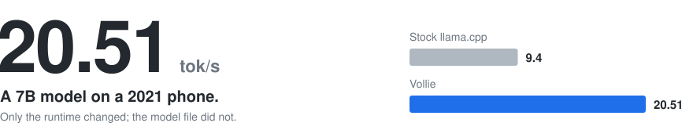
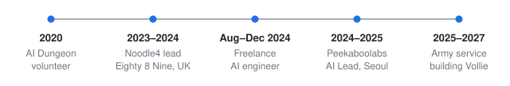

# Woobeen Back

**I make LLMs run fast on small devices, and I check my own claims.**

Seoul · remote, UTC-aligned · available Feb 2027 · [woobin3069@gmail.com](mailto:woobin3069@gmail.com) · [LinkedIn](https://linkedin.com/in/woobeen-back-a29ba5259)

Open to remote roles in on-device / edge LLM inference, model compression, and mobile AI.

Median of 10 runs on one phone and one model, +1.91% perplexity inside a +2% budget set beforehand. Stock 9.4 is from Nov 4, Vollie 20.51 from Nov 8, same phone and file. The number depends on the phone's memory state: a later day printed 11.46 ([R57](https://github.com/hoeio/vollie/blob/main/campaigns/02-25toks-5pct/STATUS.md)). [Check it without a phone](https://github.com/hoeio/vollie/blob/main/tools/reproduce.sh).

I patch llama.cpp for ARM phones: NEON kernels, expert prefetch, quantization. AI agents write much of the code; I set the rules, run every phone test, and decide what counts.

Agents drift toward making an experiment pass. [The rules](https://github.com/hoeio/vollie/blob/main/RULES.md) and the logs (R11, R25) show where I stopped them. A same-day control (R57) is how I found my own headline number did not hold.

## Work

- **[Vollie](https://github.com/hoeio/vollie)** (Android, [Google Play](https://play.google.com/store/apps/details?id=com.insaneutils.vollie)): the runtime above, built during Army service.
- **[Ollie](https://apps.apple.com/kr/app/ollie-private-ai-talk/id6740768187):** on-device chatbot shipped at Peekaboolabs, where I owned all AI and MLOps on a 4-person team. Product Hunt Product of the Week #3. Its SDK is open source ([Lora-SDK](https://pub.dev/packages/lora_sdk)).
- **[Compression](https://github.com/hoeio/test-ondevice):** EXAONE 3.5 2.4B came out 35% smaller than its public Q8_0 at +2.4% English perplexity (best of ten variants; the report lists all).
- **[ChatFLY](https://github.com/hoeio/ChatFLY), [NeuralPet](https://github.com/hoeio/neuralpet):** fly mushroom-body simulations, controls and null results kept.

<b>How I work with AI</b>

- **They stop and ask.** In [ChatFLY](https://github.com/hoeio/ChatFLY), more than ten decision records show the agent laying out options and me choosing, before the run.
- **They cannot bend the rules.** Agents drift toward making an experiment pass: a run planned on a cleaned phone (withdrawn, R11), a quality budget widened after the result (declined, Nov 5), a speedup from a bad control (withdrawn, R25). The rules are in [`RULES.md`](https://github.com/hoeio/vollie/blob/main/RULES.md).
- **Failures stay on the record.** Failed gates, withdrawn claims, and a same-day control showing my headline number did not hold on a later day (R57).
- **Fast, with checks.** Vollie's second campaign went from R50 (Nov 13) to a pre-registered R65 (Nov 17); ChatFLY went through eight gated phases in four days.

<b>Experience</b>

### Mandatory Military Service — Republic of Korea Army
*Aug 2025 – Feb 2027*

- Built internal automation tools for an artillery brigade, used by 30+ personnel.
- Won an Army Ideathon award (2026); completed the KAIST SW Education Center AI-SW course for ROKA (2026).

---

### AI Lead — Peekaboolabs
*Dec 2024 – Jul 2025 · Seoul, on-site · 4-person seed-stage startup, accepted to Smilegate's Orange Planet (Apr 2025); a ₩500M seed round was announced in Nov 2025, after my departure*

**Scope:** owned every AI model, all MLOps, and model compression for the company's on-device products.

**Shipped:**

- **[Ollie](https://apps.apple.com/kr/app/ollie-private-ai-talk/id6740768187)**, an on-device AI chatbot. [Product Hunt](https://www.producthunt.com/products/lora-2) Product of the Week #3.
- **[Lora-SDK](https://pub.dev/packages/lora_sdk)**, the on-device LLM SDK behind Ollie, open-sourced as a Flutter package (few packages could run on-device models in Flutter).
- **[Carve](https://web.archive.org/web/20250622214924/https://carve.peekaboolabs.ai/)** (site as of Jun 2025), an on-device AI optimization platform: 100+ waitlist, a "BBB" technology rating from KIBO (Korea Technology Finance Corporation).

**Also:**

- Converted open models to GGUF/GGML or TFLite and tested them on real phones (e.g. EXAONE 3.5, Gemma 3, Llama 3.2, Mistral 7B), and compressed the originals with several techniques.
- Used usage data from the live app to see that demand was strongest among users on modest phones without NPU support, so I targeted models under 2–3 GB. Ollie came out of that.
- Ran models on-device across every project: ONNX Runtime (first, in a mobile photo-editing app), then GGUF with llama.cpp after moving to Flutter, plus Core ML on iOS and LiteRT on Android. Worked on Core ML and NPU (Snapdragon, Exynos) optimization.
- Worked with Intel and LG on on-device AI projects. Part of the Korea University Startup Station (KUBS) and Seoul Startup Hub × 500 Global expansion program cohorts.
- Hired after a freelance project with the founder.

---

### Freelance AI Engineer
*Aug – Dec 2024 · remote*

- **Livestock monitoring:** a YOLO-based vision system that flags abnormal animal behavior. *Working system.*
- **On-device personalization:** fine-tuned Stable Diffusion on a user's selfies with several LoRA approaches to generate images on the phone. *Prototype.*
- **Screen agent:** a vision model finds UI elements on a computer screen and Selenium clicks them. *Working system.*

---

### Lead AI Engineer — Eighty 8 Nine (later Technical Adviser)
*Feb 2023 – Aug 2024 · remote, UK · full-time alongside university studies*

- Led 4 engineers to launch **[Noodle4](https://web.archive.org/web/20240430172023/https://www.noodle4.com/)** (site as of Apr 2024), an AI service that matches brands with influencers and reviews submitted video ads.
- Owned VQA and LLM development and MLOps deployment, working with 3 frontend/backend engineers. Researched newer Llama-based VQA approaches and put them into production.
- Built the content-review system with ViLT, LLaVA, and qllama (VQA was the main challenge); added a basic defense against influencers gaming the review (inserting content or other tricks to pass the AI check or inflate scores); deployed on AWS.

---

### Volunteer contributor (unpaid) — Latitude / AI Dungeon
*Jul 2020 – Nov 2021 · remote, US · while in high school*

- Joined by sending the team a technical proposal; ran model-compression experiments (distillation, quantization, pruning).

<b>Projects</b>

### Vollie

- Speed comes from a router-weight expert-skip rule, a two-stage output head, a sampler fast path, and a fused expert kernel. The bit-identical part of the runtime alone gives 12.0.
- Got OpenCL running on the Adreno 660 GPU after diagnosing three blockers (an OpenCL 2.0 mismatch, lost native logs, a kernel-compiler bug), then measured it at 0.7–2.9 tok/s, always below the CPU. Serving stays on the CPU, with a self-check that falls back if a driver misbehaves.
- Saves the model's state after each reply, so a follow-up in a 2,000-token chat is read in ~3 s instead of ~110 s (calculated from measured read speed, not measured end-to-end).
- Wrote up what did not help next to what did: draft-model speculation (0.48–0.76× the plain rate on the phone), n-gram, EAGLE-3 and MTP drafting, early exit (+2.5% perplexity for the cheapest layer), and several cache and kernel ideas.
- The [Android app on Google Play](https://play.google.com/store/apps/details?id=com.insaneutils.vollie) carries the same final campaign-1 configuration (research build 2.2.21+44, kit r16), so anyone can try it on their own phone and send back a report.

---

### Compression at Peekaboolabs

| Model | Size vs. public Q8_0 | Perplexity change |
|---|---|---|
| EXAONE 3.5 2.4B | 35% smaller (1.84 GB vs 2.84 GB) | +2.4% English, +3.2% Korean |
| Gemma 3 1B | 25% smaller | +2% English, +7% Korean |

The two best of ten compressed files; [the report](https://github.com/hoeio/test-ondevice) lists all ten, including one 3B variant at +453% English perplexity. llama.cpp on WikiText-2 and a Korean Wikipedia sample, context 512, first 30 chunks, so differences of a few percent are within noise. Reference is Q8_0, not FP16. Re-run on a Mac in Nov 2026.

---

### Fly mushroom-body research

- **[ChatFLY](https://github.com/hoeio/ChatFLY):** eight simulated flies hold a 300-turn Toki Pona conversation, with replies exactly right 99.7% of the time on new test seeds (synthetic wiring, rate model; controls and failed gates are in the repo).
- **[NeuralPet](https://github.com/hoeio/neuralpet):** pre-registered plans and 20+ seeds; real fly wiring did not beat a degree-preserving shuffle ([report](https://github.com/hoeio/neuralpet/blob/main/reports/FINAL.md)).
- Both were built with AI coding assistance; see each repo's `CLAUDE.md`.

---

### Open source

- [llama.cpp #31378](https://github.com/ggml-org/llama.cpp/pull/31378): a Metal kernel for `GET_ROWS_BACK`, tested on an M4 Pro with `test-backend-ops`. Under review. The PR shows where it is slower than the CPU.

<b>Research, awards, education</b>

### Research

- **AI4F — 1st Workshop on LLMs and Generative AI for Finance, ACM ICAIF 2024 (Nov 14, 2024), poster accepted** ([OpenReview](https://openreview.net/forum?id=av3zeO8K7h)): *Enhancing Portfolio Rebalancing Timing Using GPT: A Macroeconomic Indicator Approach.* An LLM plus a quantitative pipeline that reads macroeconomic indicators to time rebalancing, with backtesting. Second author.
- **Korean Data Analysis Society, Summer 2024 conference:** *Time-lag Prediction Using Language Models for Events Leading to the U.S. Presidential Election* — predicts the time lag between linked political events from timelines.
- **[SKKU LAMDA Lab R&E (2021–2022)](https://web.archive.org/web/20261031145539/https://sites.google.com/site/hyoh79/research), as a high school student:** Hybrid Attention Unet++, SNN-Transformer, NFT abuse detection.

---

### Awards — 13 AI and data competition awards, 2020–2023

| Year | Award |
|---|---|
| 2020 | Data Creator Camp — Grand Prize |
| 2020 | Gyeonggi-do Data Industrial Manpower Training Project — Grand Prize |
| 2020 | Seoul National Univ. TCE × AI Code Fair — Excellence Prize |
| 2021 | Data Creator Camp — Top Prize |
| 2021 | Hanyang Univ. Artificial Intelligence Task — Grand Prize |
| 2021 | Yonam Institute of Technology Prediction Contest, High School League — Grand Prize |
| 2021 | Gaion New Business Using Trading Big Data — Award |
| 2021 | Korea Power Exchange Public Data Application — Award |
| 2022 | Intflow Creative Hackathon, NIA75 AI Contest — Gold Prize (livestock estrus-sign detection) · press: [Hankook Today](https://www.hantoday.net/news/articleView.html?idxno=37006), [AI Times](https://www.aitimes.com/news/articleView.html?idxno=148418) |
| 2022 | Korea Univ. Pediatric X-ray Data Assignment — Grand Prize |
| 2022 | Pohang Technopark Quantum Computing AI SW Development Competition, Development (Problem-Solving) category — Award · press: [Newsworks](https://www.newsworks.co.kr/news/articleView.html?idxno=701430), [Jeonmae](https://www.jeonmae.co.kr/news/articleView.html?idxno=933035), [GB Prime News](https://www.gbprimenews.com/news/articleView.html?idxno=129507) |
| 2023 | Small Business Data Analysis and Utilization Contest, Service Development — Award |
| 2023 | KIMFT Innovation Idea Contest — Award |

*Rank names are English translations of the Korean originals.*

---

### Education

- **Kyung Hee University** — Industrial and Management Systems Engineering (2023–). On leave for mandatory military service (completes Feb 2027).
    - 1:1 Mentoring Program (2023–) · KHU Ambassador for CES (2023–2024)
- **Korea Digital Media High School** — Dept. of Hacking Defense (2020–2022)
    - Student Mentor, Machine Learning course (2021–2022) · Leader of a beginner ML study group (2022)
    - Mentor for AI development club "Fregic" (2021–2022) · AI advisor (NPC AI) for game development club "Cracker" (2021)
- **Other:** Rendezvous, AI research club — member and free-club leader (2020–2021) · Fregic, AI development club (2022) · KISTI Cyber Guardians (2021) · National Management Strategy Institute, Youth National Finance Master (2023–2024) · KAIST SW Education Center Military Personnel AI-SW course (2026)

<b>Skills and press</b>

### Skills

- **On-device & model work:** llama.cpp (C/C++ CPU-kernel patches), GGML/GGUF, KV-cache quantization, Android NDK, ONNX Runtime, LiteRT, Core ML, model compression (quantization, distillation, pruning), LoRA fine-tuning, VQA, YOLO, Stable Diffusion
- **Stack:** Python, JavaScript, Flutter, PyTorch, TensorFlow, GCP, AWS

---

### Press

- [Peekaboolabs career site — company history (KO, archived)](https://web.archive.org/web/20261031150434/https://career.peekaboolabs.ai/history): how the founder met and hired me as its first team member, AI Lead.
- [Wowtale, Apr 2025 (EN)](https://wowtale.net/2025/04/25/240348/): Peekaboolabs accepted to Smilegate's Orange Planet.
- [Platum (KO)](https://platum.kr/archives/262349): Peekaboolabs selected for a global expansion program.
- [AI Times (KO)](https://www.aitimes.com/news/articleView.html?idxno=148418): Intflow NIA75 AI Contest award, livestock estrus-sign detection.

